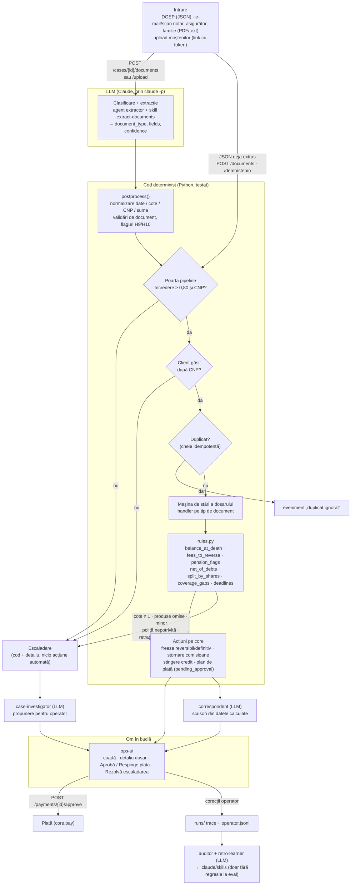

# Arhitectura: Agentul de Succesiune

Documentul explică ce face fiecare modul, cum trece un document prin sistem, unde lucrează LLM-ul și unde cod
determinist, cum se reproduce totul și cum s-ar lega sistemul de bancă și registre reale.

Comenzile din §5 au fost verificate pe 2026-10-28, pe commitul `cd43ed0`, pe un checkout curat. Contextul de business e în `BRIEF.md`, iar
regulile, cu sursele lor, în `kb/`.

## 1. Principiul

**LLM-ul citește și scrie text; codul calculează și decide.** Un document intră ca text sau PDF. Un LLM îl
clasifică și extrage câmpurile, cu un scor de încredere. Din acel moment totul e determinist: validări, mașina de
stări, solduri la data decesului, stornări, cote și planul de plată.

Ce iese din mâna agentului:
- **Plata nu pleacă niciodată fără aprobarea unui om.**
- **Documentele nesigure merg la un operator:** încredere sub 0,80, CNP lipsă sau diferit, cote care nu dau suma 1.

## 2. Harta modulelor

| Modul | Ce face | Interfața |
|---|---|---|
| `agent/api.py` | Server HTTP (FastAPI). Toate documentele trec prin `_receive()`, care scrie și trace-ul. Servește UI-ul la `/ui/`. | `GET /health`, `GET /cases`, `GET /cases/{id}`, `GET /escalations`, `POST /documents` (JSON extras), `POST /cases/{id}/documents` (fișier → extractor), `POST /payments/{id}/approve` și `/reject`, `POST /escalations/{case}/{esc}/resolve`, `POST /operator/feedback`, `GET /audit`, `POST /messages`, `POST /cases/{id}/upload-token` + `GET/POST /upload`, `POST /demo/reset`, `GET /demo/documents`, `POST /demo/step/{n}?variant=A\|B`, `POST /demo/run` |
| `agent/extract.py` | Pasul LLM: `extract(text, name, hint)` îl apelează pe `claude -p` cu promptul agentului `extractor` și skill-ul `extract-documents`. Urmează `postprocess(doc, text)`, determinist: normalizează date, cote, CNP și sume și validează la nivel de document (cifre de control, flaguri pentru antet derutant / fără CNP). | `extract(...) -> {document_type, confidence, fields, ...}` |
| `agent/guard.py` | 076, poarta de siguranță: înainte de LLM verifică tipul real al fișierului, limitele, PDF-ul activ sau cu text ascuns (PyMuPDF), tiparele de injecție RO/EN, caracterele invizibile și JSON-ul în afara schemei. După LLM: verdictul pentru pipeline (`high` ⇒ carantină, `suspicious_document`), spotlighting-ul cu nonce în prompturi, `defang` pe citate, `check_output` pe ce scriu agenții (`unsafe_output`). Detalii în `docs/SECURITY.md`. | `inspect(path_or_bytes, name) -> {risk, flags, sanitized_text}`, `verdict(doc)`, `check_output(text, ibans, cnps, urls)` |
| `agent/pipeline.py` | Orchestrarea deterministă: poarta de încredere (0,80), identificarea clientului, idempotența, câte un handler pe tip de document, acțiunile pe core, escaladările, planul de plată. | `Pipeline(bank).receive(doc) -> {case_id, state, actions, escalation?, missing}`; `approve_payment(case_id, approver)` |
| `agent/case_state.py` | Dosarul și mașina de stări. Starea se deduce din etapele (milestones) atinse, nu dintr-o secvență, deci documentele pot veni în orice ordine. Ține evenimente cu regula aplicată, escaladări și lista „ce lipsește”. | `Case.state()`, `log()`, `escalate()`, `missing()`, `to_dict()` |
| `agent/rules.py` | **Funcții pure, testate, numai sume întregi în bani și fracții exacte:** `balance_at_death`, `fees_to_reverse`, `pension_flags`, `mandate_withdrawals`, `net_of_debts`, `validate_shares`, `largest_remainder`, `split_by_shares`, `coverage_gaps`, `deadlines`. | apeluri de funcții; fără stare |
| `agent/core_mock.py` | Simulatorul core-ului bancar (clienta demo RC1001 și un al doilea client). Metodele corespund contractului din `kb/tech/api-contract-bank.md`. | `Bank.find_customer`, `find_by_name_birth`, `product_by_iban`, `product_by_loan_contract`, `products`, `movements`, `freeze`, `reverse_fees`, `settle_loan`, `pay`, `reset(variants)` |
| `agent/demo_documents.py` | Cele 7 documente demo și cazurile grele H1–H11, deja extrase. Le încarcă din `registries/documents/**/*.mvp.json`. Demo-ul, testele și eval-ul folosesc aceleași valori. | `DOCUMENTS`, `VARIANT_B`, `HARD["H1".."H11"]` |
| `agent/trace.py` | Jurnalul fiecărei rulări, citit de auditor și de bucla de învățare. | `runs/<run_id>/trace.jsonl`, `operator.jsonl`, `cases/` |
| `.claude/agents/` | Agenți LLM (Claude Code subagents): `extractor` (text → JSON cu scor), `case-orchestrator` (document → extractor → API → decide), `case-investigator` (escaladare → propunere pentru operator), `correspondent` (scrisori din datele dosarului), `heir-communicator` (cere documentele lipsă moștenitorilor), `auditor` (verifică regulile după rulare), `retro-learner` (actualizează skill-urile din erori). | prompturi Markdown; codul din `agent/` nu e modificat de agenți |
| `.claude/skills/` | Cunoștințe acumulate, citite de agenți: `extract-documents`, `succession-domain`, `escalation-playbook`, `correspondence`, `heir-messaging`. Bucla de învățare le crește. | `SKILL.md` |
| `registries/documents/` | Documentele demo: text (`.md`), PDF (`pdf/`), ground truth bogat (`.json`) și ground truth în forma pipeline-ului (`.mvp.json`). În `hard/` sunt cazurile de test H1–H11. | fișiere; specificația e în `kb/scenariu-demo/documente-demo.md` |
| `registries/generator/` | Generatorul de PDF, determinist și fără dependențe: PDF-uri cu text pentru 02–06, scanare degradată (imagine) pentru 07. | `python -m registries.generator` |
| `scripts/eval_extract.py` | Măsoară extractorul pe ground truth-ul `.mvp.json`: pe document, pe câmp și pe set (main / hard). | ieșire în `runs/eval-latest.json`; cod de ieșire 1 sub `--min` |
| `scripts/autopilot.py` | Procesul de fundal care automatizează fluxul: urmărește `registries/inbox/` → extracție → `POST /documents`, apoi cheamă agenții (investigator la escaladare, correspondent la scrisori, heir-communicator + `POST /messages` când lipsesc documente, auditor după fiecare lot). Scrie artefactele în directorul de rulare al serverului. | `--watch` (implicit), `--once`, `--demo [--extracted] [--variant B]`; API: `GET /cases/{id}/artifacts`, `GET /autopilot/status` |
| `scripts/retro.py` | Bucla de învățare: eval → retro-learner actualizează skill-urile → eval; schimbarea se păstrează doar dacă nu scade scorul. | `--cycles N` |
| `scripts/smoke_e2e.py` | Testul cap-coadă pe serverul viu: start curat (`POST /demo/reset?inbox=true`), cele 7 documente prin `POST /inbox` → autopilot (extracție LLM + agenți), apoi valorile exacte din scenariu, mesajele, scrisorile și plata aprobată (PAID). `scripts/ui_e2e.py` verifică apoi ops-ui în Chromium (toate taburile, consolă curată, capturi în `runs/e2e/`). | `--api`, `--timeout`, `--json`; tabel PASS/FAIL + cod de ieșire |
| `coordonare/bin/promoveaza` | Promovează un commit pe serverul de demo stabil: checkout în `<checkout stabil>`, rulează testele, refuză dacă sunt roșii, repornește `:8000`. | `promoveaza [commit]` |
| `ops-ui/` | Panoul operatorului, static, fără build: coada de dosare, detaliul, aprobarea plății, escaladările, încărcarea de documente. Merge pe API sau pe `mock-data.json`. | `index.html`, `app.js` |
| `kb/` | Baza de cunoștințe cu surse: legi, proceduri bancare, șabloane de documente, decizii tehnice, scenariul demo cu valorile exacte. | Markdown |
| `tests/` | 30 de teste: `test_rules.py` (funcțiile pure) și `test_pipeline.py`: scenariul end-to-end A/B, ordine inversă, duplicat, cote ≠ 1, cazurile H4 (CNP greșit), H5 (fără IBAN), H10/H11 (extras fără CNP, sigur / ambiguu). | `pytest` |

## 3. Fluxul unui document



Pentru demo, `POST /demo/step/n` trimite direct JSON-ul deja extras. Asta sare peste pasul LLM și face demo-ul
reproductibil. Pe un fișier real, același document trece prin extractor.

## 4. Unde e LLM și unde e cod determinist

| Pas | LLM | Determinist |
|---|---|---|
| Ce fel de document e, ce câmpuri are | ✔ (`extractor`) | |
| Normalizare (date în litere, cote în cuvinte, CNP cu spații), cifre de control | | ✔ `postprocess` |
| Poarta de încredere, identificarea clientului, idempotența | | ✔ `pipeline` |
| Starea dosarului | | ✔ `case_state` |
| **Solduri, dobânzi, comisioane de stornat, pensie de returnat, net de datorii, cote, rotunjire, termene** | **niciodată** | ✔ `rules` (sume întregi în bani, `Fraction`) |
| Ce produse lipsesc din certificat | | ✔ `coverage_gaps` |
| Plata | | ✔ calculul; **omul aprobă** |
| Textul scrisorilor (notar, supliment, asigurător, moștenitori) | ✔ (`correspondent`, `heir-communicator`) | cifrele vin din dosar, nu din model |
| Propunerea la o escaladare | ✔ (`case-investigator`) | decizia e a operatorului |
| Verificarea după rulare | ✔ (`auditor`) | regulile verificate sunt fixe |
| Învățarea | ✔ (`retro-learner` scrie în skills) | păstrată doar dacă `eval_extract` nu scade |

Ce garantează codul:
- Din extracție, `pipeline.py` folosește câmpuri identificatoare: CNP, numere, date și cote ca fracții.
- Sumele de plată către moștenitori se calculează din soldurile din core, nu din document.
- **Singura sumă luată din document** e indemnizația din răspunsul asigurătorului (`amount`, `_on_insurer_response`).
  Ea stinge creditul, nu se plătește nimănui. Azi nu e comparată cu principalul la data decesului; vezi „Limite
  cunoscute”.
- O cotă extrasă greșit nu poate produce o plată: `validate_shares` cere suma exact 1, iar planul așteaptă aprobarea
  umană.

## 5. Reproducere (comenzi verificate)

Toate comenzile se rulează din rădăcina repo-ului.

```bash
# 0. mediul (o singură dată), Python 3.11
python3 -m venv .venv
.venv/bin/pip install fastapi "uvicorn[standard]" pydantic pytest httpx python-multipart claude-agent-sdk

# 1. testele: valorile exacte ale scenariului + „și dacă…?” + H4/H5/H10/H11
.venv/bin/python -m pytest -q tests                      # 30 passed

# 2. PDF-urile documentelor demo (stdlib, determinist: aceleași sha256 la fiecare rulare)
.venv/bin/python -m registries.generator                 # 17 PDF-uri: documents/pdf/ (7) + documents/hard/pdf/ (10)

# 3. evaluarea extractorului (apelează `claude -p`; cere CLI-ul `claude` logat)
DEMO_MODE=1 .venv/bin/python scripts/eval_extract.py              # 01–07 + H1–H11 (~19 apeluri LLM, câteva minute)
DEMO_MODE=1 .venv/bin/python scripts/eval_extract.py --only 05    # un document (~8 s)
DEMO_MODE=1 .venv/bin/python scripts/eval_extract.py --set hard   # doar cazurile grele

# 4. serverele
coordonare/bin/promoveaza [commit]     # :8000 = demo STABIL (worktree <checkout stabil>, DEMO_MODE=1 implicit);
                                       #         refuză commit-uri cu teste roșii
DEMO_MODE=1 .venv/bin/uvicorn agent.api:app --port 8001 --reload   # :8001 = dezvoltare, din rădăcina repo-ului
curl -s localhost:8000/health                                       # {"status":"ok"}; UI la http://localhost:8000/ui/

# 5. demo-ul în 7 pași
curl -s -X POST localhost:8000/demo/reset                           # varianta implicită: pensie (pensia din octombrie vine)
for n in 1 2 3 4 5 6 7; do curl -s -X POST localhost:8000/demo/step/$n; echo; done
#   stări: FROZEN → NOTARY_ANSWERED → INSURANCE_CLAIM_OPEN → SUPPLEMENT_REQUESTED → INSURANCE_SETTLED
#          → PAYMENT_PENDING_APPROVAL; doc 7 → escaladare în SC-NEIDENTIFICAT
curl -s -X POST "localhost:8000/demo/run?variant=B"                 # tot scenariul, varianta cu testament
curl -s localhost:8000/cases/SC-2026-0001 | python3 -m json.tool
curl -s -X POST localhost:8000/payments/PAY-SC-2026-0001/approve \
     -H 'content-type: application/json' -d '{"approver":"ops"}'      # approved; net cont curent 527337 bani (scenariu §2.3)

# 5b. variantele scenariului (core_mock.VARIANTS)
curl -s -X POST "localhost:8000/demo/reset?variants=pensie,retragere"   # + Andrei retrage 1.000 lei pe 2026-09-10:
                                                                        #   flag + escaladare, raportat notarului
curl -s -X POST "localhost:8000/demo/reset?variants="                   # fără pensia din octombrie (fără retur CNPP)

# 5c. cazurile grele H1–H11 (registries/documents/hard/README.md), trimise ca JSON deja extras
curl -s -X POST localhost:8000/documents -H 'content-type: application/json' \
     -d @registries/documents/hard/H10-extras-multilingv-fara-cnp.mvp.json     # după doc 1: freeze definitiv, fără escaladare
#   H11 → escaladare în SC-NEIDENTIFICAT; H2 → nicio acțiune nouă (idempotent)

# 5d. autopilotul: tot fluxul cu agenții, pe serverul de dezvoltare
DEMO_MODE=1 .venv/bin/uvicorn agent.api:app --port 8001 &
.venv/bin/python scripts/autopilot.py --demo                       # cele 7 documente (.md/.json) în inbox la 20 s;
                                                                    #   extracție LLM + agenți (~1 min/document)
.venv/bin/python scripts/autopilot.py --demo --extracted --interval 5   # fără extracție LLM (.mvp.json), doar agenții
.venv/bin/python scripts/autopilot.py --once                       # ce e acum în registries/inbox/, apoi iese
curl -s localhost:8001/autopilot/status                             # run_dir, running, procesate, apeluri de agenți, erori
curl -s localhost:8001/cases/SC-2026-0001/artifacts                 # scrisori, mesaje, investigații + audit

# 6. UI-ul separat, fără API (date mock)
cd ops-ui && python3 -m http.server 8080                 # http://localhost:8080/?mock=1

# 7. bucla de învățare (apeluri LLM)
DEMO_MODE=1 .venv/bin/python scripts/retro.py --cycles 1
```

Ce e determinist:
- pașii 1, 2, 5, 5b, 5c și 6 dau același rezultat la fiecare rulare;
- valorile așteptate sunt în `kb/scenariu-demo/maria-ionescu.md` §2–§3 și în
  `registries/documents/**/*.json` (`expected_agent`).

Pașii 3 și 7 depind de LLM și dau un scor, nu o valoare exactă; fiecare rulare e salvată în `runs/`.

## 6. Configurare

| Variabilă | Implicit | Efect |
|---|---|---|
| `DEMO_MODE` | nesetat (`1` implicit în `promoveaza`) | `1` acceptă CNP-urile și IBAN-urile mascate ale demo-ului (`2XXXXXXXXXXXX`, `RO00 RZBR …`): sare doar peste cifrele de control, nu și peste formă. Nu se folosește în producție. |
| `EXTRACT_MODEL` | `sonnet` | modelul folosit de `claude -p` în `agent/extract.py` |
| `EXTRACT_TIMEOUT` | `120` | secunde pe un apel de extracție |
| `RUN_ID` | timestamp UTC | numele directorului din `runs/` pentru trace (și pentru artefactele autopilotului) |
| `AUTOPILOT_API` | `http://localhost:8001` | serverul pe care lucrează autopilotul (implicit dezvoltarea, nu demo-ul stabil) |
| `AUTOPILOT_MODEL` | `sonnet` | modelul agenților chemați de autopilot (`claude -p`, timeout 180 s pe apel) |
| `DEPLOYMENT_MODE` | **neimplementat** | prevăzut în BRIEF (`internal` \| `hub`): ar schimba doar adaptorul de intake (§7). Azi există numai modul intern. |

Constante în cod: pragul de încredere `CONFIDENCE_THRESHOLD = 0.80` (`agent/pipeline.py`); variantele scenariului
(`pensie`, `retragere`) se aleg la `Bank.reset(variants)`.

## 7. Legarea la sistemele reale (adaptoare)

Logica (`pipeline`, `rules`, `case_state`) nu știe de unde vin datele. Fiecare sursă sau destinație externă e un
adaptor cu aceeași interfață ca mock-ul:

| Sistem | Azi (mock) | În producție | Ce se schimbă |
|---|---|---|---|
| **Core banking** | `agent/core_mock.py` (`Bank`) | clientul pentru cele 6 endpoint-uri din `kb/tech/api-contract-bank.md`: freeze, products-at-date, fees/reverse, payment-plan, payments (+ approve), cases | o clasă `CoreClient` cu aceleași metode ca `Bank`, injectată în `Pipeline(bank)`. Sumele rămân în bani, datele în ISO. |
| **DGEP / Evidența Populației** | linia JSON din `registries/documents/01-dgep-semnal.json` (format generat de noi, `kb/tech/dgep-integration.md` §3) | lotul periodic (fișier text cu delimitatori, prin SFTP) + web service-ul de verificare la cerere, din acordul DGEP–bancă | un adaptor de intake care transformă fiecare linie în `{document_type: "dgep_signal", fields: {cnp, date_of_death, …}}` și o trimite la `POST /documents`. Semnalul DGEP face doar **freeze reversibil**; definitiv devine la certificatul de deces. |
| **Asigurător (UNIQA)** | documentele 03/05 ca text | avizarea daunei prin canalul asigurătorului (e-mail cu formularul F1 sau portalul de daune) + răspunsul de aprobare | un adaptor de ieșire pentru avizare (`correspondent` scrie textul, un om îl trimite) și unul de intrare pentru răspuns (prin extractor sau, dacă există, API structurat) |
| **Notar** | documentele 02/04/06 ca text/PDF | adresele vin pe hârtie sau e-mail, scanate în registratura băncii | intake: scanare → `POST /cases/{id}/documents`. Răspunsul către notar e generat, semnat de doi oameni, trimis pe canalul registraturii. |
| **Moștenitori** | outbox mock (`POST /messages`), link de upload cu token | e-mail / SMS / app prin canalele băncii | adaptorul de mesagerie; linkul de upload rămâne același endpoint |
| **LLM** | `claude -p` local (contul echipei) | Claude printr-un endpoint în regiune UE, în perimetrul băncii (BRIEF: „LLM în regiune UE, nimic nu iese”) | doar `agent/extract.py` (și agenții) schimbă clientul. Calculele nu depind de LLM. |

**Modul hub (Faza 2, `DEPLOYMENT_MODE=hub`)**, neimplementat: un hub multi-bancă primește notificările de deces
și documentele, iar banca expune aceleași 6 endpoint-uri. Hub-ul vede doar referințe și sume; calculul rămâne în
bancă. În cod s-ar schimba doar adaptorul de intake (de unde vin documentele), nu `pipeline` și nici `rules`.

## Necunoscut / limite cunoscute
- Formatul real DGEP și macheta reală UNIQA nu sunt publice; mock-urile sunt construite după contractele și
  documentele publice citate în `kb/tech/dgep-integration.md` și `kb/bank-procedures/asigurare-viata-credit.md`.
- Indemnizația extrasă din răspunsul asigurătorului (doc 05) e aplicată pe credit fără comparație cu principalul la
  data decesului din core. E propusă ca validare în raportul 038, pentru owner-ul `agent/`.
- Persistența dosarelor e în memorie (`Pipeline.cases`): se pierde la repornirea serverului. Pentru producție trebuie
  o bază de date. Trace-urile din `runs/` rămân.
- Starea câmpurilor din extracție (redenumirile din DECISIONS „Evaluarea extracției”) e în aliniere: vezi
  `docs/ALINIERE-AGENT.md`.
